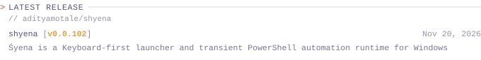
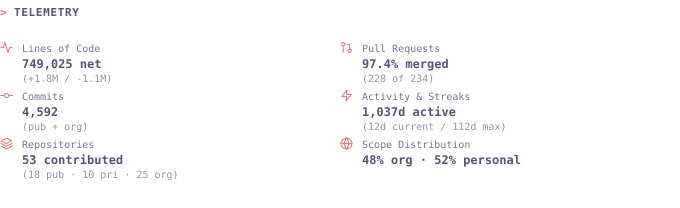
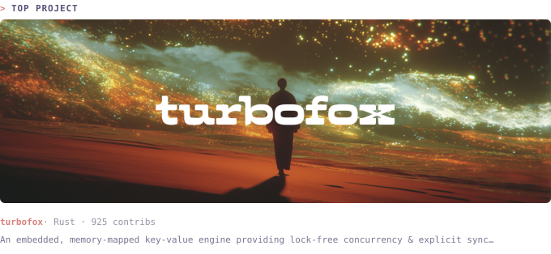

<a id="top"></a>

[](https://adii.fyi) [](https://adii.fyi/adityamotale.pdf) [](https://github.com/adityamotale/adityamotale/releases) [](https://github.com/adityamotale) [](https://x.com/arctic_byte) [](https://www.linkedin.com/in/aditya-motale) [](https://github.com/adityamotale/adityamotale/actions/workflows/test.yaml) [](https://github.com/adityamotale/adityamotale/actions/workflows/activity.yaml) [](https://github.com/adityamotale/adityamotale/actions/workflows/release.yaml)


<a id="latest-release"></a>

<a href="https://github.com/adityamotale/shyena/releases/tag/v0.0.102"></a>

<a id="telemetry"></a>




<a href="https://github.com/pid7-org/turbofox"></a>

## <a id="writing"></a>~ WRITING

-  [**There's More to Performance Than Big-O**](https://adii.fyi/blogs/theres-more-to-performance-than-big-o) &mdash; <sub>Sep 15, 2026</sub>

<p>
   <sub><a href="https://adii.fyi/blog">view all posts &rarr;</a></sub>
</p>

## <a id="languages"></a>~ LANGUAGES

<table width="100%">
  <tr>
    <td width="50%">
       <b>Primary Language</b><br />
      <code>Rust 72.6%</code> <sub>(1.16M loc)</sub>
    </td>
    <td width="50%">
       <b>Codebase Volume</b><br />
      <code>1.60M loc</code> <sub>(29 languages tracked)</sub>
    </td>
  </tr>
</table>

```text
Rust         [██████████████████████████          ]  72.6%   1.16M loc
TypeScript   [███                                 ]   8.2%  130.3k loc
Assembly     [█                                   ]   4.0%   64.0k loc
Python       [█                                   ]   3.6%   56.7k loc
JavaScript   [█                                   ]   3.0%   47.6k loc
Other        [███                                 ]   8.7%  138.4k loc
```

---

<p align="center">
  <a href="https://adii.fyi"><b>aditya</b></a> &nbsp;&#183;&nbsp;
   <a href="https://github.com/adityamotale">github</a> &nbsp;&#183;&nbsp;
   <a href="https://x.com/arctic_byte">twitter</a> &nbsp;&#183;&nbsp;
   <a href="https://www.linkedin.com/in/aditya-motale">linkedin</a> &nbsp;&#183;&nbsp;
   <a href="https://adii.fyi/adityamotale.pdf">resume</a> &nbsp;&#183;&nbsp;
   <a href="https://adii.fyi">website</a> &nbsp;&#183;&nbsp;
   <a href="https://adii.fyi/rss.xml">rss</a> &nbsp;&#183;&nbsp;
  <a href="#top"><code>[eof]</code></a>
</p>
