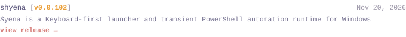
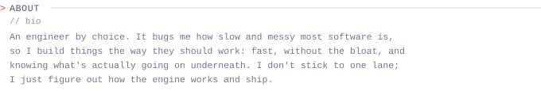
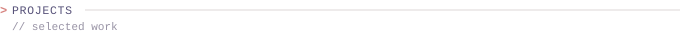
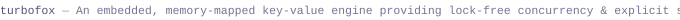
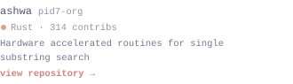
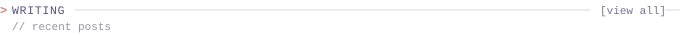
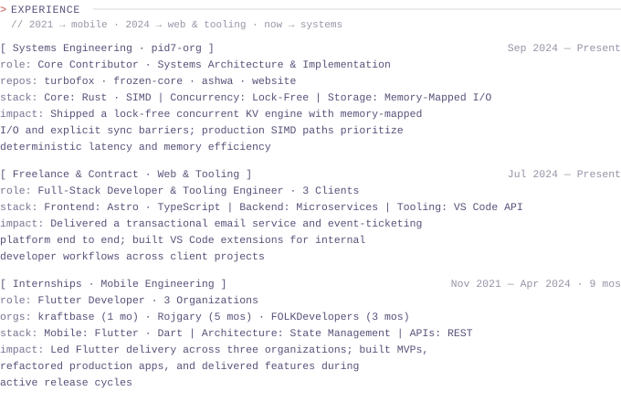
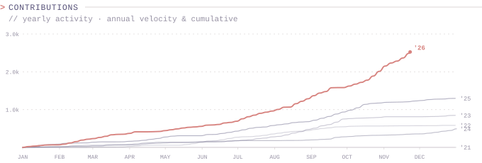
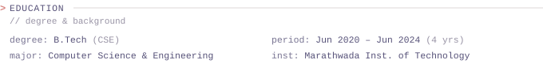

        

<table width="100%">
  <tr>
    <td width="50%" valign="top">
      <a href="https://github.com/pid7-org/turbofox">
         
        
      </a>
    </td>
    <td width="50%" valign="top">
      <a href="https://github.com/pid7-org/ashwa">
         
        
      </a>
    </td>
  </tr>
  <tr>
    <td width="50%" valign="top">
      <a href="https://github.com/adityamotale/shyena">
         
        
      </a>
    </td>
    <td width="50%" valign="top">
      <a href="https://github.com/pid7-org/turbo_crc">
         
        
      </a>
    </td>
  </tr>
</table>

